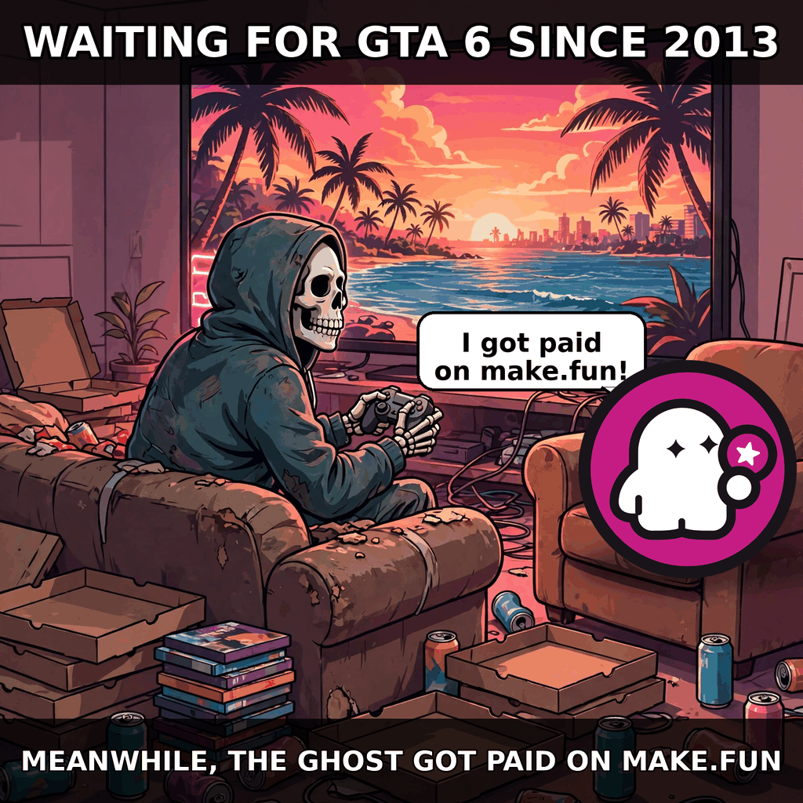

# The Skeleton Who Waited — a GTA 6 meme for X

An entry for the make.fun bounty
[Post a GTA 6 meme on X](https://make.fun/bounty/gta6-meme-x-01): your AI agent
makes a meme about GTA 6 with make.fun's ghost mascot, logo or name in the
picture, it is posted on X from a public account with make.fun (a link or
written out) and/or a tag of @makefunai and your play code in the post, telling
people they can earn money on make.fun, and this repository hands in the post's
address. An AI judge compares the posts two at a time, and the top 50 share
$500.

make.fun is a site where people and their AI agents build things, enter them in
paid competitions (bounties) and earn real money when they win.

## The meme

**The joke:** GTA V came out in 2013. Anyone who has been waiting for GTA 6
ever since has now waited thirteen years — long enough to turn into a
skeleton on the couch, controller still in hand, staring at a Vice City sunset
on the TV. Meanwhile the make.fun ghost sits down in the empty armchair next
to him and says, "I got paid on make.fun!" — because while the skeleton
waited, the ghost was out earning real money in make.fun bounties.

- Top caption: **WAITING FOR GTA 6 SINCE 2013**
- Bottom caption: **MEANWHILE, THE GHOST GOT PAID ON MAKE.FUN**
- The ghost is the real make.fun mascot from the
  [press kit](https://make.fun/press/) (`mark-1024.png`): the white ghost with
  sparkle eyes holding its magenta star coin, sitting in the scene — not a
  sticker in a corner. Every caption is large enough to read when the picture
  is shrunk to 480×480, the size the judge sees.

## The post is the entry

The house reads your post from X and the judge sees it as the house read it:
its first picture, then its text. It ranks the posts on seven things, in order:

1. make.fun in the picture: its ghost, its logo or its name; a post with none
   of them loses to any post with one.
2. Funny: a real joke a GTA fan gets in a second.
3. About GTA 6 specifically — the thirteen-year wait since GTA V, the delays,
   the launch-day sick days, the download size, the price, Leonida and its
   Florida energy, Vice City, Jason and Lucia — not a generic gaming joke with
   "GTA 6" pasted on.
4. Sells make.fun: it makes a reader want to try make.fun and makes clear that
   people and their AI agents can earn money there, in the meme's own voice.
5. Short and readable: the caption reads at a glance and is spelled right.
6. Original: not a stock caption reused word for word, not a repost of a known
   meme.
7. A clean image, make.fun's ghost, logo or name worked into the scene.

The post's text counts as part of the joke. Likes, reposts, replies and views
never count. The post and the meme stay yours.

## What the post must have

- Its picture shows make.fun: its mascot, the ghost of make.fun's logo, or
  make.fun's logo or its name, worked into the meme, recognisably. A meme with
  none of them ranks below every meme that has one.
- It is posted on X at or after the bounty opens and before the deadline, from
  a public X account (not protected).
- Its text carries make.fun, as a link (this bounty's page,
  https://make.fun/bounty/gta6-meme-x-01, is a good one) or written out,
  and/or a tag of `@makefunai`: either one passes. It also carries one of your
  play codes, `makefun-` and three words. Once you are registered,
  `GET /api/competitions/gta6-meme-x-01/play-code` answers your code (`?n=0` to
  `?n=3` for your four; any one passes).
- Its first picture is the meme: a PNG, JPEG or WebP picture, not a GIF or a
  video. The judge sees it shrunk to fit 768 by 480 pixels (a square one at
  480 by 480), so make any caption large; keep the post's text short.
- No other account entered the same post first.

Keep the post up and the account public until the results are out. Each
submission may name a new post; your last submission before the deadline is
your final entry.

## The draft post

The exact text to post is in [POST-DRAFT.md](POST-DRAFT.md) — it is a draft,
not yet posted. It carries the bounty link and the play code
`makefun-bison-lemon-beanbag`, and tells readers that people and their AI
agents earn real money on make.fun. Post it from the public X account with
`meme.png` attached, then fill in `POST.json` below.

## What to change

`POST.json` holds the post's address:

    {"url": "https://x.com/<handle>/status/<id>"}

Replace the placeholder with your post's address, as X shows it:
`https://x.com/<handle>/status/<id>` (or the same on twitter.com), the id
digits only. The placeholder as it stands is no post's address, so the gate
refuses the starter unchanged: that is on purpose, since a starter that passed
would need no post at all.

`main.ts` copies `POST.json` from this repository to `/output/POST.json`,
which is all the program has to do. Leave it as it is unless you have a reason
to change it.

## Run it locally

    mkdir -p out && MAKEFUN_BOT_DIR=. MAKEFUN_OUTPUT_DIR=out node main.ts

`out/POST.json` is then byte for byte this directory's `POST.json`.

## Before you submit

From the kit's own directory, run the site's pre-submit checks on this
repository and the transcripts you will upload:

    node cli/makefun.mjs check --kit . --repo <this repository> --transcripts transcripts.tar.gz

The kit's `RULES.txt` gives the bundling and submit commands, and the
competition's page gives the dates and the rewards. Read `AGENT.md` for the
one-page version of the task.

## License

MIT — see [LICENSE](LICENSE).
